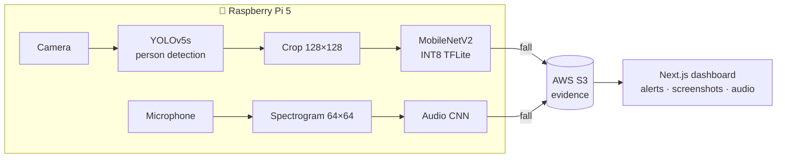
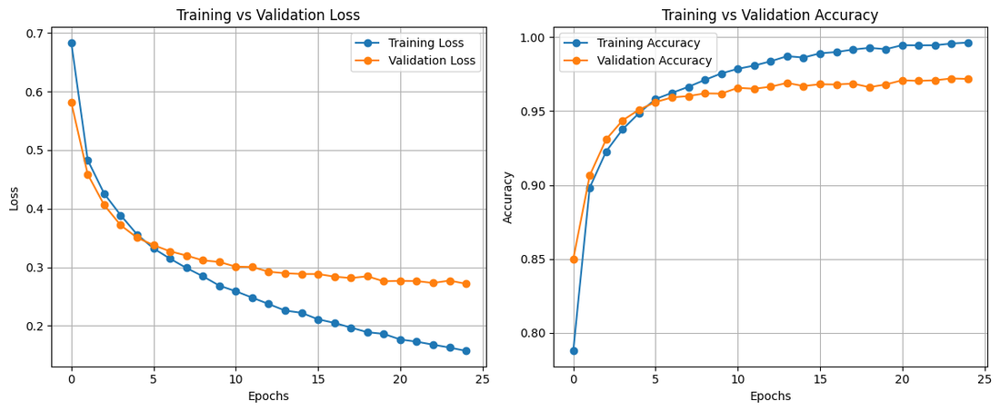
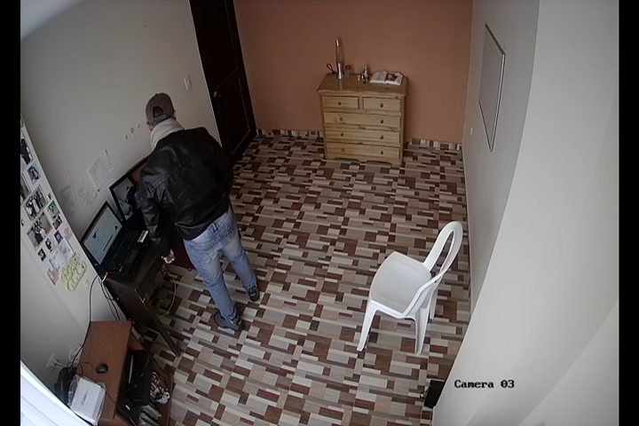

<div align="center">

# 🧓 Fall Detection System using Edge AI

**Real-time, dual-mode (video + audio) fall detection running on a Raspberry Pi 5, with cloud alerts and a live web dashboard.**


| 🎯 Test accuracy (video model) | 📦 Edge model size | ⚡ Quantization |
|:-:|:-:|:-:|
| **96.59%** | **9.5 MB** (TFLite) | **Full INT8** |

</div>



## 📋 Project Overview

A comprehensive **Edge AI application** for real-time fall detection using Raspberry Pi. The system employs dual-mode detection (video and audio) to accurately identify falls and provide immediate alerts through a web-based monitoring interface.

**Module:** Edge AI

**Platform:** Raspberry Pi 5

**Detection Modes:** Video-based (Computer Vision) + Audio-based (Sound Analysis)

**Deployment:** Edge Computing with Cloud Integration


## ✨ Key Features

### Dual Detection Modes
- ✅ **Video-Based Detection** - Computer vision using TensorFlow Lite and YOLOv5
- ✅ **Audio-Based Detection** - Sound analysis using spectrogram-based CNN
- ✅ **Real-Time Processing** - Low-latency inference on Raspberry Pi
- ✅ **Web Dashboard** - Next.js frontend for monitoring and alerts
- ✅ **Cloud Integration** - AWS S3 for storing alerts and evidence
- ✅ **Alert System** - Immediate notifications when falls are detected

### Technical Highlights
- **Edge Optimization** - TensorFlow Lite models for efficient inference
- **Multi-Modal AI** - Combining visual and audio signals
- **Real-Time Processing** - Live camera and microphone input
- **Cloud Backup** - Automatic upload of detection evidence
- **Responsive UI** - Modern web interface for monitoring

## 🛠️ Technology Stack

### Edge Device (Raspberry Pi)
- **Hardware:** Raspberry Pi 5
- **OS:** Raspberry Pi OS
- **Python:** 3.x
- **Frameworks:**
  - TensorFlow Lite - Optimized model inference
  - PyTorch - YOLOv5 object detection
  - OpenCV - Computer vision processing
  - TensorFlow/Keras - Audio model inference

### Frontend
- **Framework:** Next.js 15.2.4
- **Language:** TypeScript
- **Styling:** Tailwind CSS 4
- **Cloud Services:** AWS S3, Azure Blob Storage

### AI Models
- **Video Model:** TensorFlow Lite (`models/Fall-detector-lite.tflite`)
- **Object Detection:** YOLOv5 (`models/yolov5s.pt`)
- **Audio Model:** Keras CNN (`models/best_model*.keras`)

## 📁 Repository Structure

```
Fall-Detection-using-Raspberry-Pi/
├── detection-model/                  # Video-based fall detection
│   ├── real_time_detector.py         # Live camera + mic detection on the Pi
│   ├── video_detector.py             # Run detection on a video file
│   ├── train_fall_classifier.ipynb   # MobileNetV2 training + INT8 TFLite export
│   ├── models/                       # Fall-Detector.h5, Fall-detector-lite.tflite, yolov5s.pt
│   └── samples/                      # my-video.mp4 test clip
│
├── sound-detection-model/            # Audio-based fall detection
│   ├── train_sound_model.py          # Spectrogram CNN training (GroupKFold)
│   ├── train_sound_model_v2.py       # Variant with evaluation report + confusion matrix
│   ├── live_audio_test.py            # Record 3 s from the mic and classify
│   ├── models/                       # best_model*.keras + SavedModel export
│   ├── data/                         # X.npy, y.npy preprocessed spectrograms
│   ├── samples/                      # live_input.wav
│   └── templates/                    # HTML template
│
├── assets/                           # README images
│
└── edge-frontend/                # Web monitoring dashboard
    ├── src/
    │   └── app/
    │       ├── page.tsx         # Main dashboard
    │       └── api/              # API routes
    └── package.json

```

## 🏗️ System Architecture


### Components

1. **Video Detection Module**
   - Real-time camera feed processing
   - TensorFlow Lite model inference
   - YOLOv5 object detection
   - Frame-by-frame analysis

2. **Audio Detection Module**
   - Live audio capture
   - Spectrogram generation
   - CNN-based classification
   - Sound pattern analysis

3. **Web Dashboard**
   - Real-time monitoring
   - Alert visualization
   - Evidence viewing
   - Historical data access

## 🚀 Getting Started

### Installation

1. **Clone the repository**
   ```bash
   git clone https://github.com/minudakaliyanage/Fall-Detection-using-Raspberry-Pi.git
   cd Fall-Detection-using-Raspberry-Pi
   ```

2. **Install Python dependencies**
   ```bash
   pip install tensorflow opencv-python torch torchvision
   pip install sounddevice scipy pydub
   pip install boto3 python-dotenv certifi
   ```

3. **Install frontend dependencies**
   ```bash
   cd edge-frontend
   npm install
   ```

4. **Configure environment variables**
   ```bash
   # Create .env file
   AWS_REGION=your-region
   AWS_ACCESS_KEY_ID=your-key
   AWS_SECRET_ACCESS_KEY=your-secret
   AWS_BUCKET_NAME=your-bucket
   ```

### Running the System

#### Video Detection
```bash
cd detection-model
python real_time_detector.py
```

#### Audio Detection
```bash
cd sound-detection-model
python live_audio_test.py        # live mic test
python train_sound_model.py      # retrain (set dataset_dir first)
```

#### Web Dashboard
```bash
cd edge-frontend
npm run dev
# Open http://localhost:3000
```

## 📊 Model Information

### Video Detection Model
- **Architecture:** MobileNetV2 (ImageNet weights), last 20 layers fine-tuned
- **Format:** TensorFlow Lite (.tflite), 9.5 MB
- **Input:** 128x128 RGB person crops (from YOLOv5 bounding boxes)
- **Output:** Binary classification (Fall/Non-Fall)
- **Optimization:** Full INT8 post-training quantization for edge deployment
- **Test accuracy:** **96.59%** (test loss 0.293)

<p align="center">
  
  <br/><sub>Training vs validation loss / accuracy of the MobileNetV2 fall classifier</sub>
</p>

<p align="center">
  
  <br/><sub>Example camera frame of the kind the video detector processes</sub>
</p>

### Audio Detection Model
- **Architecture:** CNN with spectrogram input
- **Format:** Keras (.keras)
- **Input:** 64x64 spectrogram images
- **Output:** Binary classification (Fall/Non-Fall)
- **Preprocessing:** Audio → Spectrogram conversion

### YOLOv5 Integration
- **Purpose:** Object detection and person tracking
- **Model:** YOLOv5s (small variant)
- **Use Case:** Person detection before fall classification

## 🔍 Detection Workflow

### Video Detection Flow
1. Capture frame from camera
2. Preprocess image (resize, normalize)
3. Run YOLOv5 for person detection
4. Crop person region
5. Run TensorFlow Lite model
6. Post-process results
7. Trigger alert if fall detected
8. Upload evidence to cloud

### Audio Detection Flow
1. Capture audio sample (3 seconds)
2. Convert to spectrogram
3. Preprocess spectrogram (resize, normalize)
4. Run CNN model inference
5. Classify as fall/non-fall
6. Trigger alert if confidence threshold met
7. Save audio evidence

## 🎨 Web Dashboard Features

### Dashboard Components
- **Real-Time Monitoring** - Live detection status
- **Image Gallery** - Screenshots of detected falls
- **Audio Playback** - Listen to detected audio samples
- **Alert History** - Timeline of all detections
- **Confidence Scores** - Display prediction confidence
- **Auto-Refresh** - Updates every 10 seconds

### API Endpoints
- `/api/screenshots` - Get detection screenshots
- `/api/audio-files` - Get audio evidence files
- `/api/alerts` - Get alert information

## 📈 Performance Metrics

### Model Performance
- **Video Model:** 96.59% test accuracy (MobileNetV2, INT8 TFLite)
- **Audio Model:** Several CNN variants trained with GroupKFold cross-validation (see `sound-detection-model/`)
- **Audio window:** 3-second clips

### Edge Optimization
- **Model Size:** Video model 9.5 MB as INT8 TFLite (vs 21 MB Keras `.h5`)
- **Memory Usage:** Optimized for Raspberry Pi constraints
- **CPU Usage:** Efficient inference on ARM processor

## 🔧 Configuration

### Detection Parameters
- **Video Frame Rate:** 30 FPS
- **Audio Sample Rate:** 16 kHz
- **Audio Duration:** 3 seconds
- **Confidence Threshold:** Configurable
- **Consecutive Frames:** Fall confirmation logic

### Cloud Storage
- **AWS S3:** Primary storage for evidence
- **Azure Blob:** Alternative storage option
- **Upload Trigger:** Automatic on fall detection


## 📚 Dependencies

### Python (Edge Device)
```
tensorflow>=2.10.0
torch>=1.12.0
opencv-python>=4.6.0
sounddevice>=0.4.5
scipy>=1.9.0
numpy>=1.21.0
boto3>=1.26.0
python-dotenv>=0.20.0
```

### Node.js (Frontend)
```
next>=15.2.4
react>=19.0.0
@aws-sdk/client-s3>=3.787.0
@azure/storage-blob>=12.27.0
tailwindcss>=4.0.0
```

## 📄 License

This project is intended for educational and portfolio purposes.

---

**Note:** This is an Edge AI project demonstrating real-world deployment of deep learning models on resource-constrained devices for healthcare and safety applications.
